# TurboDial 2 (TD2): App features and SOPs

**For:** Miguel Ababon and the Club Wealth team · **Date:** 11/24/2026 · **Version:** DRAFT v1
**Companion to:** `TD2_game_plan_week_of_2026-11-23.md` (the migration plan). This document is separate: it covers what each screen does and how to do common tasks.

**How this was made:** read-only. I opened every TD2 screen and all 54 Help pages while logged in as the account Owner. I didn't save, add, toggle or send anything.

- **(checked on screen)** means I saw it on the real TD2 screen.
- **(to check)** means it comes from Help only, or I'd have had to click Add/Save/Call to see it.

---

## ⚠ Read first: 3 things found on screen today

1. **Calls and texts with no caller ID chosen go out as (253) 215-8426.** Settings > TurboDial > Phone Numbers says: *"Default caller ID: Not set. Nothing chosen yet, so calls and texts go out as (253) 215-8426."* This is the PlusThis number from the 11/17 problem. TD2 labels it "EVENTS TEAM (Liz Capili)". The Owner's Dialer also shows it selected as Caller ID. **Fix: SOP 7.** (checked on screen)
2. **Moving a number to TD2 is a switch in the number's own form, not "Add Phone Number".** All 171 Twilio numbers are already listed in TD2. Each number's form has two switches, **Use Turbodial 2.0 Voice** and **Use Turbodial 2.0 SMS**. The form notes that turning them off reverts the number to the TD1 address. They are ON for (253) 201-0640 and OFF for (206) 460-1572. These are the two forms I opened. The 4 numbers without "(calls only)" (215-8230, 201-0542, 201-0640 and 215-8303) are most likely the 4 that have them on. "Add Phone Number" **buys a new number**. (checked on screen; what the switch does in Twilio is **to check** with TurboDial)
3. **"Release Number"** is a red button at the bottom of every number's form. **Never click it.** It gives up the number.

---

# Part 1: App features (a short tour)

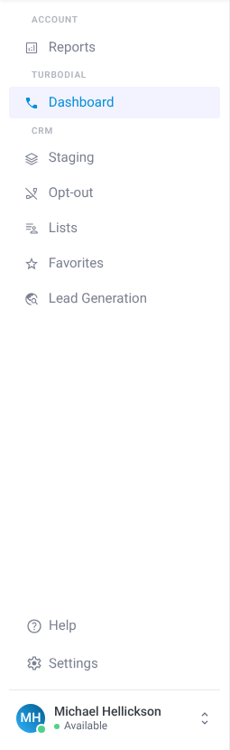{width=22%}

## Left menu

| Menu | Where | What it's for |
|---|---|---|
| **Account > Reports** | Left menu | Call reports by **Agents**, **Phone Numbers** or **Scorecard**. Choose a date range, then save, schedule or export. Columns: first and last call, calls out and in, durations, answered, sent to voicemail, dispositions. |
| **TurboDial > Dashboard** | Left menu | The work screen, made of widgets. Includes Contact Search, Timeline, Dialer, Calls, Contact History, All Messages, Sessions, and Voicemail and Notifications at the top right. You make calls and send texts here. |
| **CRM > Staging** | Left menu | TD2's own contact list (not Keap). Add or import contacts, tags, Landline Scrub. |
| **CRM > Opt-out** | Left menu | Numbers that must not get texts and/or calls. You can opt them out, opt them back in, import and export. It holds 1 record today. |
| **CRM > Lists** | Left menu | Contact lists for calling sessions ("Master List", Create Cadence). It's empty today. |
| **CRM > Favorites** | Left menu | Contacts saved for quick dialing. It's empty today. |
| **CRM > Lead Generation** | Left menu | Search for new leads through Seamless.AI, with 100 free a month. **Not for our move.** |
| **Help** | Bottom left | Opens "Help & Documentation", which has guides and videos (list below). |
| **Settings** | Bottom left | Has 3 tabs: Account, TurboDial and CRM (below). |

## Settings > Account tab

| Item | What it's for |
|---|---|
| My Profile | Your name, email, time zone and role. |
| Billing / Invoices | Plan, seats and card. Currently a trial with 4 seats. Only the Owner can change these. |
| Key | The account API key. **Not opened. Don't screenshot or share it.** |
| Change password | Your own password. |
| **Users** | The list of TD2 users and their roles. Add users here (SOP 3). Today: Michael Hellickson (Owner), Camille Cruz (Admin), Client Care (Agent), Events Team (Agent). |
| Departments | Groups of users. None yet. |
| Custom Fields | Extra contact fields. None yet. |
| Twilio Config / Sly Broadcast Config / Account Storage Config / Webhooks | Connections to other services. **Not opened, because they can show keys.** Admin only. |
| Export Logs | Browser log file for TurboDial support. |
| Audio Settings | Choose your microphone and speakers. |

## Settings > TurboDial tab

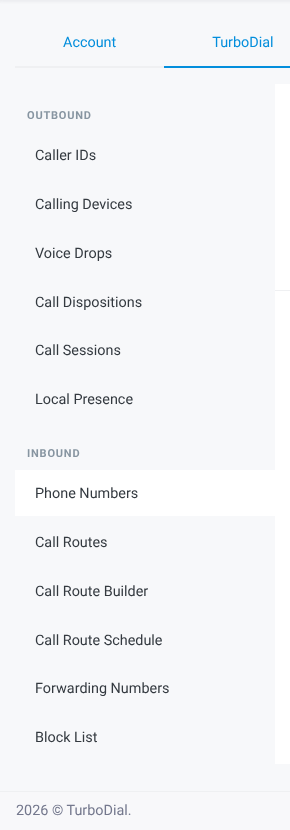{width=24%}

**Outbound**

| Item | What it's for | Today |
|---|---|---|
| **Caller IDs** | Add an *outside* number (one not in Twilio) as a caller ID. You verify it by phone. Our Twilio numbers don't need adding here. | Empty |
| **Calling Devices** | The phone your calls ring on: "This Browser" (the default), a cell or a desk phone. Each user has their own. | Empty, so the browser is used |
| **Voice Drops** | Pre-recorded voicemail messages you drop with one click. Record, or **Upload MP3**. | Empty |
| **Call Dispositions** | Call outcome labels, plus an "AI sets the disposition" switch. | 1 label ("Do Not Contact"). AI is off |
| **Call Sessions** | Rules for power-dial "boost" sessions (abandoned-call limit). | Protection is off |
| **Local Presence** | Calls out from a number whose area code matches the contact's. | **Off. Keep it off** (it could pick a PlusThis number) |

**Inbound**

| Item | What it's for | Today |
|---|---|---|
| **Phone Numbers** | **Default caller ID** box at the top, then the list of numbers. Use the pencil to open a number's form (SOP 4). Add Phone Number buys a new one. | 171 numbers. Default is **Not set** |
| Call Routes | The old route list. A banner says it is moving to Call Route Builder. | 5 routes |
| **Call Route Builder** | Draw what happens to an incoming call: Ring Group, Voicemail, Auto Greet, Phone Number, Auto Attendant, Call Route (SOP 5). | Each user has a "Default (read only)" route |
| **Call Route Schedule** | Business hours and holidays for each route. After-hours calls go to a different route. | None set |
| **Forwarding Numbers** | Outside numbers that calls can forward to. | (206) 300-1000 |
| Block List | Numbers that can't call in. | Empty |
| Call Tracking | A tracking number for each marketing source. | None |
| Voicemail Greetings | The greeting a caller hears. One per user, record or MP3 (SOP 6). | 3 test greetings |
| Hold Music | Hold and park audio. | System default |

**Calls and other features**

| Item | What it's for | Today |
|---|---|---|
| Call Recording | Outbound recording per user, inbound recording per number. | 0 of 4 users, 0 of 171 numbers |
| Media Collection | All audio in one place: greetings and voice drops. Admins and Supervisors. | 3 tests |
| Notifications | Sound, toast, browser and email alerts for texts and calls. | Defaults |
| Dashboard | Turn widgets on or off for everyone. | All on |

## Settings > CRM tab

| Item | What it's for |
|---|---|
| **Keap** (Connected) | Linked to `clubwealth.infusionsoft.com`. **Linked user: Camille Cruz**, which is who TD2 "acts as" in Keap when it logs notes. **Call notes** and **Message notes** sync is ON. There are also Contact Detail fields, Screen-pop fields, and Integrations (Call Outcome, Person Notes, and event tags such as Inbound Call Missed and Voicemail Received). (checked on screen) |
| Staging | TD2's own contacts (local). |
| Active Campaign, Agency Zoom, GoHighLevel, HubSpot | Not configured. Not used by us. |

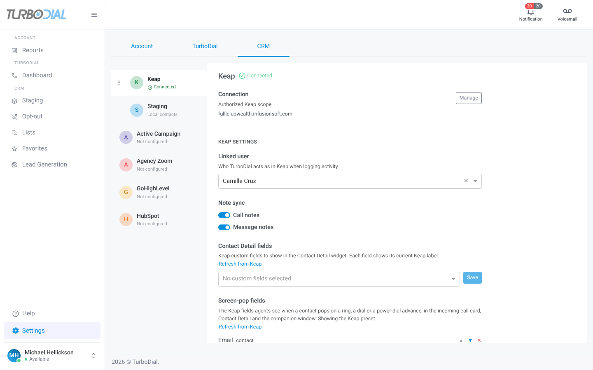{width=80%}

## Help menu topics (bottom left > Help)

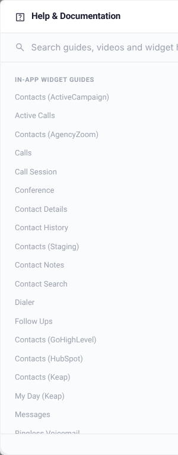{width=24%}

- **In-app widget guides:** Contacts (ActiveCampaign, AgencyZoom, Staging, GoHighLevel, HubSpot, Keap), Active Calls, Calls, Call Session, Conference, Contact Details, Contact History, Contact Notes, Contact Search, Dialer, Follow Ups, My Day (Keap) (no page yet), Messages, Ringless Voicemail, Sessions List, SMS Session, Current Session, Team Status, Timeline.
- **Account management:** Registration, Billing, Twilio Configuration, Linking and Configuring CRMs, Adding and Removing Users, Terminating your Account.
- **Browser extension:** User Manual, Privacy Policy.
- **Manual:** Video Overview, Initial Dashboard, Adding/Importing/Editing/Deleting Contacts, Caller IDs, Making Your First Call, Acquiring Inbound Numbers, Sending Your First Message, Configuring Your Dashboard, Integrating AgencyZoom, Making a Call, Voice Drops, Acquiring an Inbound Number, SMS Templates.
- **Account:** My Profile, Change Password, User Types.
- **TurboDial app:** Inbound Call Routes, Calling Devices, Voicemail Greeting, Call Dispositions, Notifications.
- **FAQs:** Twilio Basics.

---

# Part 2: SOPs

## ⛔ Do not set up

> - **The 30 PlusThis numbers and the 3 system numbers.** This includes **(253) 215-8426** (the wrong caller ID from 11/17), (253) 201-1402, (727) 287-5993, (253) 447-5788 and (253) 793-1397. They all appear in TD2's list. **Don't open and Apply their forms**, don't turn on TD2 Voice/SMS for them, and **never pick one as a Caller ID or as the Default caller ID.**
> - **The 2 parked wrong-number lines:** (253) 201-3281 and (253) 205-0538. Not unless Omerson says so.
> - **Never change the Twilio numbers, apps or messaging services** used by PlusThis, ListingAppointments or CWU. **Never click "Release Number".** **Keep Local Presence off.**
> - Full list: the game plan, section 2, "Do not set up".

## SOP 1: Call a number

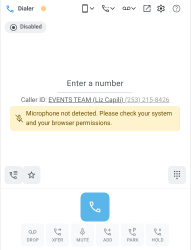{width=40%}

**From the Dialer** (Dashboard)

1. Open **TurboDial > Dashboard**. Find the **Dialer** widget. (checked on screen)
2. Check the line under the number box: **"Caller ID: …"**. It must be **your own number**. If it isn't, see SOP 7. (checked on screen)
3. Check the phone icon (**Calling Device**). "This Browser" means the call uses your computer's headset. (checked on screen)
4. Allow the microphone when the browser asks. Otherwise the Dialer shows "Microphone not detected". (checked on screen)
5. Type the number in **Enter a number**, or open the keypad (bottom right of the Dialer). (checked on screen)
6. Click the round blue **Call** button. The label next to the Dialer shows **Record** or **Disabled**; click it before the call to change it. (to check)
7. During the call: **DROP** (voice drop), **XFER** (transfer to a call route), **MUTE**, **ADD**, **PARK**, **HOLD**. (buttons checked on screen; how they behave is to check)

**From a Keap contact (inside TD2)**

1. In **Contact Search** (top left), or with the search bar (Ctrl K), type a name, number, email or company. Help says it searches all linked CRMs, Keap included. (to check)
2. Click the contact. The Dialer fills in their first number. Use the arrow to pick another of their numbers. (to check)
3. Check **Caller ID** (step 2 above), then click **Call**. (to check)

**From Keap itself**, use the Chrome extension (SOP 8).

## SOP 2: Text a contact, with a template

1. Click the contact (Contact Search, Calls or History). The **Messages** widget switches to that contact's thread. (to check)
2. If the contact has several numbers, pick one in the drop-down under the widget's header. (to check)
3. **Check the sending number ("Sending From" / Message From Number)** at the top right of the widget. It must be **your own number**. Click it to change. Replies come back to the number you sent from. (to check)
4. Type in the box and press **Send**. (to check)
5. **Template:** click **Choose Template** (bottom left of the widget), pick one, check the text, then **Send**. (to check)
6. **New template:** Choose Template > **Create Template** > name it > write the message (Settings has first- and last-name tokens) > **Public: Yes** to share it with the team > **Save**. (to check)
7. To text a number that isn't a contact, use **Input Phone Number** in the Messages widget. (to check)

**Note:** texts only work from a number that has TD2 SMS on, with an A2P campaign (SOP 4). Numbers showing "(calls only)" can't text from TD2 yet.

## SOP 3: Add a user and give them their number

*Owner or Admin only.*

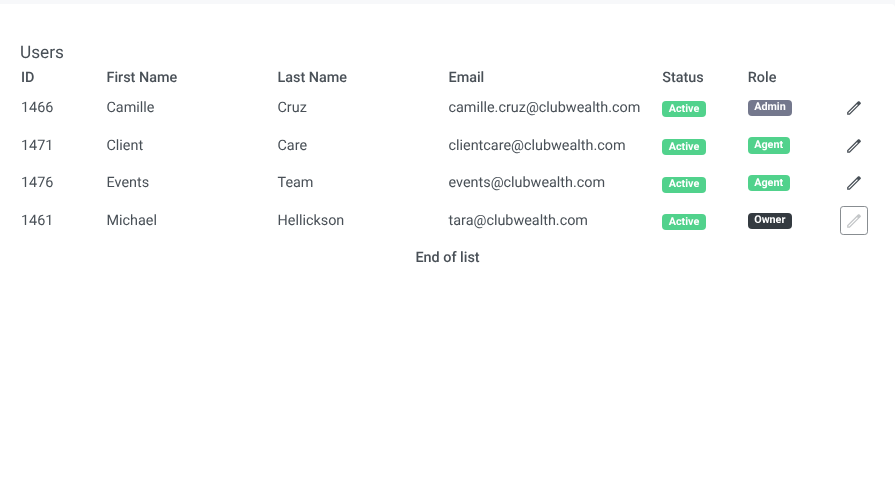{width=80%}

1. **Settings > Account > Users.** (checked on screen)
2. Click **Add User** to create the login now, or **Invite User by Email** so they set it up themselves. (buttons checked on screen; the form is to check)
3. Enter their email, first name and last name.
   - **Add User:** if the email is new, TD2 shows a **temporary password** once. Send it to the person privately. They change it in Settings > Account > Change password. (to check)
   - **Invite:** they stay "Pending" until they accept. (to check)
4. Set their **Role** in the list: Owner, **Admin**, **Supervisor** or **Agent**. **RMs: Agent.** (to check)
   - Agents can call, text and set up their own numbers, caller IDs and voice drops.
   - Only Owner, Admin and Supervisor can add numbers and routes.
   - Only Owner and Admin see every number.
5. Check that a **Default** route now exists for them in **Call Route Builder**. Each current user has one, for example "Events Team (1476)". (checked on screen for current users; for a new user it's to check)
6. **Give them their number:** do SOP 4 for each of their numbers.
   - Owner = them;
   - Forward SMS To = them;
   - Inbound Call Route = their route;
   - **Public for Caller ID = unchecked**.
7. Do SOP 7 with them: their Caller ID and Sending From number must be their own.
8. Add a seat. Billing shows 4 seats today; only the Owner can change billing. (to check)

## SOP 4: Set up a phone number

*Owner or Admin only.*

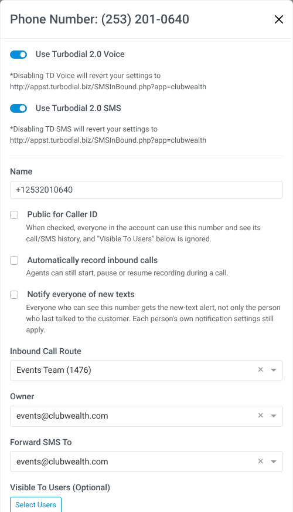{width=40%} 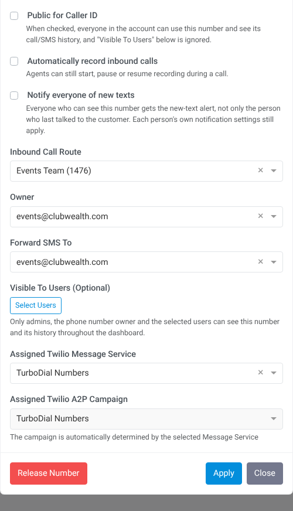{width=40%}

1. **Build the route first** (SOP 5). (Game plan gate G2.)
2. **Settings > TurboDial > Phone Numbers.** Find the number and click the **pencil** on its row. **Don't use "Add Phone Number"**: it buys a new number. (checked on screen)
3. Wait for "Checking phone number…" to finish. (checked on screen)
4. Fill in the form, top to bottom. All fields are checked on screen.

   | Field | What to set |
   |---|---|
   | **Use Turbodial 2.0 Voice** | **ON** moves incoming calls to TD2. The note says turning it off "will revert your settings to" the TD1 address. **What this does in Twilio is to check** (game plan Q2/Q5). |
   | **Use Turbodial 2.0 SMS** | **ON** moves texts to TD2. Same note. |
   | **Name** | Exactly as in the checklist. It is "+1253…" by default. |
   | **Public for Caller ID** | **Leave unchecked** for a personal number. If checked, *everyone* can call and text from it and see its history. Check it only for a shared line such as the Office. |
   | Automatically record inbound calls | As in the checklist. |
   | Notify everyone of new texts | For shared lines only. |
   | **Inbound Call Route** | The route from step 1. |
   | **Owner** | The user (their email). |
   | **Forward SMS To** | The user who should get the texts, usually the Owner. |
   | Visible To Users | Optional: other users who may see this number. |
   | **Assigned Twilio Message Service / A2P Campaign** | Shows "TurboDial Numbers" today. **Don't change it.** The campaign is set automatically from the service. |

5. Click **Apply**. Or click **Close** to leave without changes. **Never click "Release Number".** (buttons checked on screen)
6. Run the 5 tests in game plan section 3: In, No answer, Out, TxO, TxI.

**What turns "(calls only)" into SMS-enabled?** In the Default caller ID list, **167 of 171 numbers say "(calls only)"**. The only 4 without it are 215-8230, 201-0542, 201-0640 and 215-8303: the numbers already moved to TD2. 201-0640 has **Use Turbodial 2.0 SMS = ON**, and 460-1572 (which says "calls only") has it OFF. So the label most likely goes away when TD2 SMS is switched on. (pattern checked on screen; to check with TurboDial)

The Help pages also say:

- **SMS only works on numbers that came through TurboDial/Twilio;** numbers from outside can't text;
- a number used for texting **needs an A2P campaign**, or "your SMSs will not be sent". Ours show "TurboDial Numbers".

## SOP 5: Build an inbound call route

*Owner, Admin or Supervisor.*

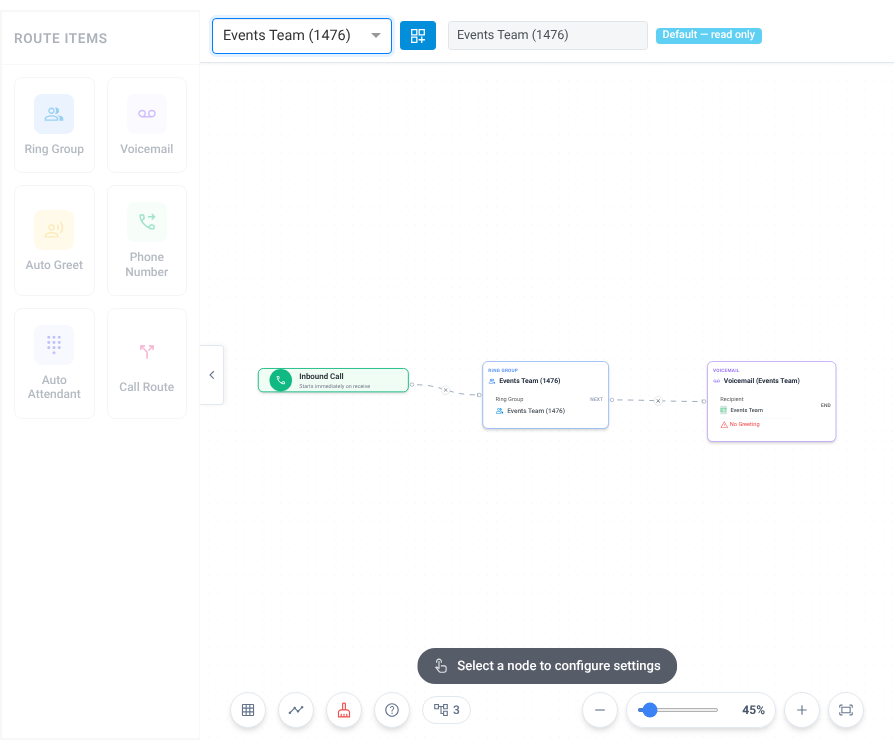{width=80%}

1. **Settings > TurboDial > Call Route Builder.** (checked on screen)
2. Pick a route from **Select a Call Route…**, or click **Create New Route** and name it. "Default" routes are **read only**, so make a new route to change one. (checked on screen; creating is to check)
3. Each route starts at **Inbound Call**. Add items from the left: click or drag. (checked on screen) The usual pattern is **Inbound Call → Ring Group → Voicemail**.
4. **Ring Group:** choose the users who ring at the same time. You can also add outside phone numbers, such as the office cell. Set **Timeout (Rings)**, the number of rings before "No Answer". Help says the default is 5. (fields checked on screen)
5. **Join the items:** drag from the dot on the right of one item to the dot on the left of the next. (to check)
6. **No answer:** choose one.
   - **Voicemail:** pick the user's voicemail. This ends the route.
   - **Phone Number:** forward to (206) 300-1000. This also ends the route.
   - **Another Ring Group:** chain a second group.

   Voicemail and Phone Number are always last. (to check)
7. Optional:
   - **Auto Greet** plays a message first;
   - **Auto Attendant** gives a "press 1 / press 2" menu. (to check)
8. Click **Save**. (to check)
9. **Schedules:** go to **Settings > TurboDial > Call Route Schedule**. Next to the route, click **Create**, set the business hours and holidays, and pick the route for after-hours calls. (list checked on screen: no schedules yet. Form is to check)
10. Attach the route to the number (SOP 4) and test it.

**Today:** the Events Team default route is **Ring Group (Events Team) → Voicemail (Events Team), "No Greeting"**. A caller who isn't answered hears no greeting. Record one (SOP 6). (checked on screen)

## SOP 6: Voicemail, voice drops, dispositions and call notes

**Voicemail greeting** (what callers hear)

1. **Settings > TurboDial > Voicemail Greetings.** Choose the agent, or "All". (checked on screen)
2. Click the **pencil** on the greeting. Then either:
   - **Start Recording**, then **Stop Recording**, and play it back; or
   - **Upload MP3**.

   Rename it, then **Save**. (to check)
3. Put it in the route: in the route's **Voicemail** item, pick that greeting (SOP 5). (to check)
4. Voicemails left by callers appear under **Voicemail** (top right of the Dashboard), and in Calls / History with a player. (checked on screen)

**Voice drop** (a pre-recorded message for answering machines)

1. **Settings > TurboDial > Voice Drops > Add Voice Drop.** (button checked on screen)
2. Name it. Tick **Public** only if the whole team should use it. (to check)
3. **Start Recording**, then **Stop Recording**, **or Upload MP3**. Play it back, then **Add**. (to check) This means old TD1 audio files *can* be uploaded (game plan Q7).
4. To use it: in the Dialer, open the **Voice Drop** menu (the tape icon) and pick the drop. During the call, **wait for the beep**, then click **DROP**. The call ends by itself. (menu checked on screen; dropping is to check)

**Call dispositions** (the call outcome)

1. Admins: **Settings > TurboDial > Call Dispositions > Add Disposition**, with a name and a description. Today there is only "Do Not Contact". "Let AI set the disposition" is **Off**. (checked on screen)
2. Agents: after a call, click the contact. In **Contact History** (or Calls), open the call and pick a **Disposition** from the drop-down. (to check)

**Call notes**

1. In **Contact History**, type in the call's **Notes** box. Clicking outside the box saves the note. (to check)
2. Or use **Contact Notes > +**: type, then **Add**. (to check)
3. Notes go to Keap as Keap notes, because "Call notes" sync is ON. **Linked user = Camille Cruz**, so check in Keap whose name the notes show. (sync setting checked on screen; result to check)

## SOP 7: Your own caller ID, and the account Default

**Why:** on 11/17, calls went out as (253) 215-8426, a PlusThis number. Today TD2 still uses 215-8426 whenever nothing else is chosen. (checked on screen)

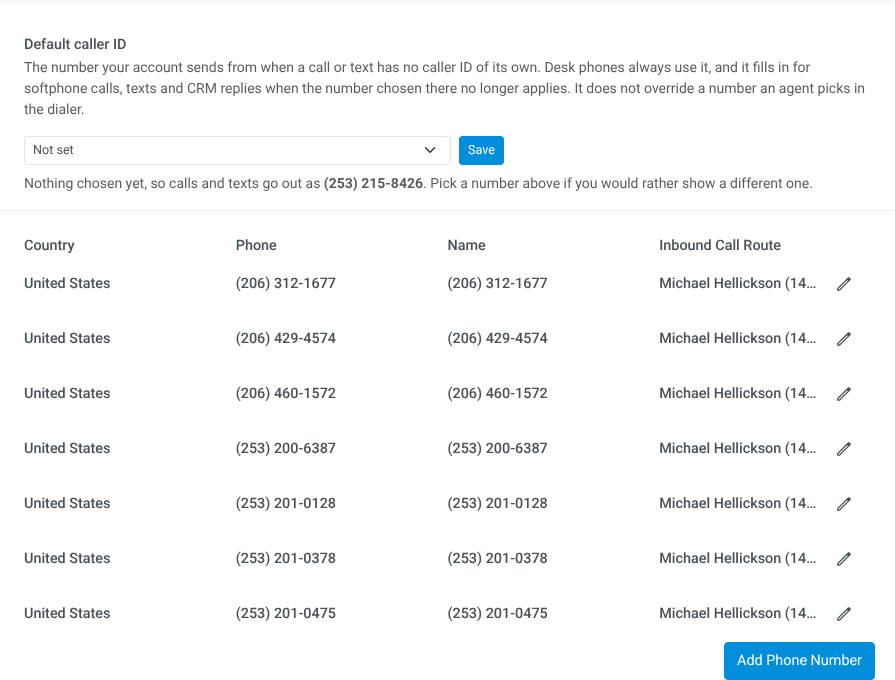{width=80%}

**A. Account Default caller ID** *(Owner or Admin, once)*

1. **Settings > TurboDial > Phone Numbers.** The box at the top is **Default caller ID**. Today it shows "**Not set**" and "*calls and texts go out as (253) 215-8426*". (checked on screen)
2. The Default is used:
   - when a call or text has no caller ID of its own;
   - **always by desk phones**;
   - for softphone calls, texts and CRM replies when the chosen number no longer applies.

   It **doesn't** override a number the agent picks in the Dialer. (checked on screen)
3. Pick a neutral Club Wealth line that is **on TD2 (Voice and SMS on)**, then click **Save**. **Never 215-8426 or any other PlusThis number.** Which line is Miguel's choice (game plan decision 10). (dropdown checked on screen; saving is to check)
4. Afterwards, the text under the box should name the new number instead of 215-8426. (to check)

**B. Each user's own caller ID** *(every user, first day)*

1. Log in as yourself. On the Dashboard, open the Dialer's **Caller ID** menu (the phone-with-arrow icon at the top of the Dialer). (checked on screen)
2. Search for and pick **your own number**. The line under the number box must read "Caller ID: *your number*". (checked on screen)
3. In **Messages**, set the **Sending From** number to your own number too (SOP 2). (to check)
4. **Test:** call and text a team test phone. The test phone must show **your** number. (game plan tests Out and TxO.)
5. Whether TD2 remembers your pick after you log out is **to check**. Look at the Caller ID line at the start of each day.

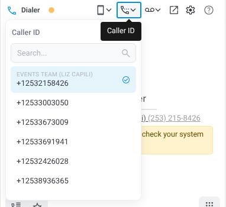{width=40%}

**C. Keep other people's numbers out of your list** *(Admin)*

- Leave **Public for Caller ID unchecked** on personal numbers, and set **Owner** correctly (SOP 4). Help says only admins, the owner and "Visible To" users can see a non-public number. (to check for Agents; the Owner login sees every number)
- **Caller IDs** (Settings) is only for outside numbers that aren't in Twilio. You don't need it for our numbers. (checked on screen)

## SOP 8: The Chrome extension (calling from Keap)

1. **Install:** in Chrome, open Help > Browser Extension > User Manual and click "HERE". Or go to the Chrome Web Store and search for **"TurboDial Browser Plugin"** (`chromewebstore.google.com/detail/turbodial-browser-plugin/nhpieaejopcpbobdlflnlfglemmgfokb`). Click **Add to Chrome**, then pin it. (link checked in Help; installing is to check)
2. **Keep TD2 open** in a Chrome tab (app.turbodial.com, Dashboard), logged in as yourself. (to check)
3. **Check your Caller ID first:** in that TD2 tab, the Dialer's "Caller ID:" line must show **your own number** (SOP 7). The extension uses whatever the Dialer has selected. (to check)
4. Open a contact in **Keap**. The extension puts a **Call button** to the right of each US phone number, including phone boxes in Keap. (to check)
5. **Hover:** with the extension setting **"Show Buttons on Hover"**, the buttons appear when you hover over the number. (to check) Help doesn't describe a hover card with contact details. Check that with TurboDial.
6. **Call:** click the **Call button**. TD2 opens the Dashboard, fills in the number and **dials straight away**. (to check)
7. **Menu button** (next to Call):
   - **Focus in TurboDial** opens the contact in TD2, with details, texts and history;
   - **Create Staging Contact** adds the number to TD2 Staging. (to check)
8. **Pop-up:** click the extension icon to see every number on the page. Clicking a number calls it right away. (to check)
9. **Check the number you called from:** after the first call, look in TD2 **Calls / History**. The call shows *your name and your number*. Also ask the person called which number they saw. (to check)

---

## What I verified / what I assumed

**Verified on screen (read-only, 11/24):**

- Every left-menu screen, and every Settings item except Key, Twilio Config, Sly Broadcast, Account Storage and Webhooks (skipped because they can show keys).
- All 54 Help pages.
- **Default caller ID = Not set**, so calls and texts go out as **(253) 215-8426**. The Owner's Dialer also has 215-8426 selected.
- A number's form, opened for (206) 460-1572 and (253) 201-0640 and closed without saving. Fields: TD2 Voice/SMS switches, Name, Public for Caller ID, recording, Route, Owner, Forward SMS To, Visible To, Message Service/A2P, and the **Release Number** button.
- 171 numbers are listed in TD2, and 167 say "(calls only)". The 4 that don't are 215-8230, 201-0542, 201-0640 and 215-8303.
- 4 users and their roles. 5 routes. The Events Team route: Ring Group → Voicemail, with **no greeting**.
- Keap is connected, with linked user Camille Cruz and note sync on.
- Local Presence is off. Recording is off everywhere. Voice Drops is empty. Forwarding has (206) 300-1000.

**Assumed or still to check (ask TurboDial support):**

- What the **TD2 Voice/SMS switches** change in Twilio, and whether switching them off is the clean rollback (Q2/Q5).
- That **TD2 SMS on** removes "(calls only)" and that texting works with the "TurboDial Numbers" service (Q4).
- The Messages screen ("Sending From", **Choose Template**). I didn't open a contact.
- The Add User, Create Route, Route Schedule and Voice Drop forms (I didn't click Add or Create).
- Whether the Dialer remembers each user's Caller ID, and whether Agents only see their own numbers.
- Everything in the **Chrome extension** steps. I didn't install it or open Keap, and the "hover for contact details" card isn't in Help.
- That saving the account Default stops the fallback to 215-8426 for desk phones and CRM replies.
