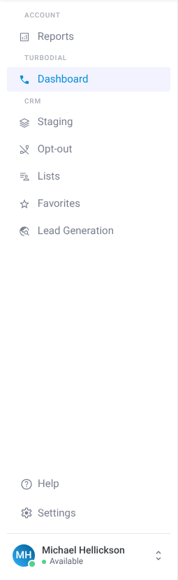
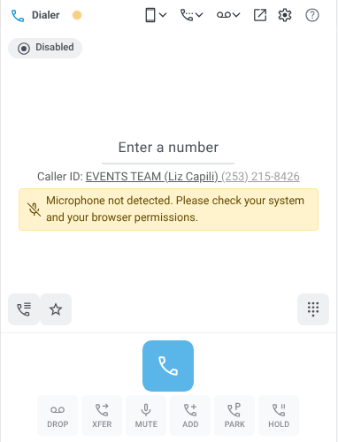
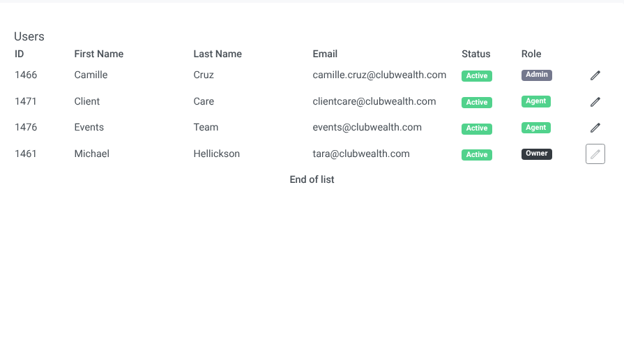
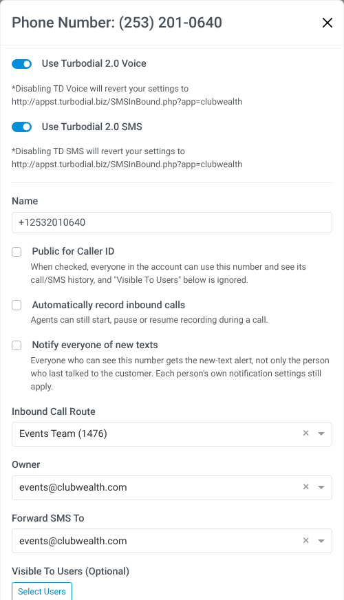
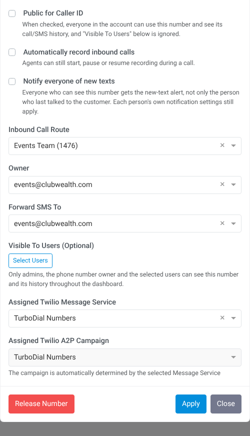
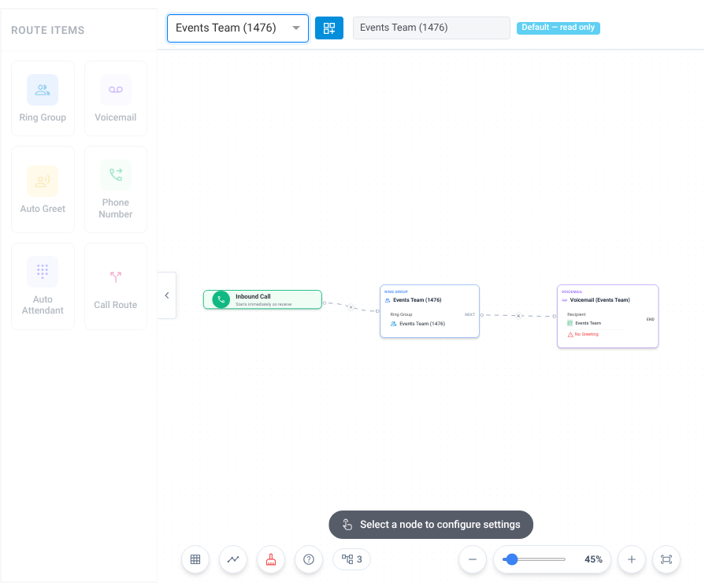
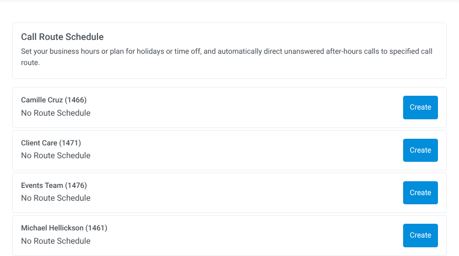
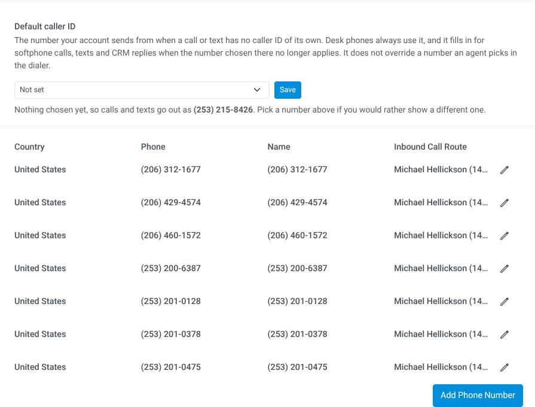
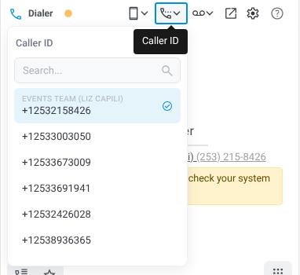
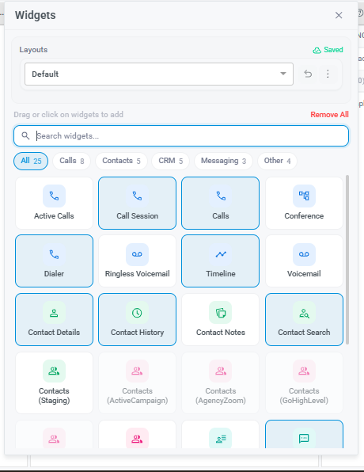

# The app at a glance {data-eyebrow="Overview"}

TurboDial 2 is where we make calls, send texts and handle incoming calls. It's linked to Keap, so calls and notes show up on the Keap contact.

{.side width=150px}

| Menu | What it's for |
|---|---|
| **Reports** | Call totals per agent or per phone number, for any date range. You can save, schedule or export a report. |
| **Dashboard** | The work screen. Calls, texts and contact history all happen here. |
| **Staging** | TurboDial's own contact list, separate from Keap. |
| **Opt-out** | Numbers that must not get calls or texts. |
| **Lists** | Contact lists for calling sessions. |
| **Favorites** | Contacts saved for quick dialing. |
| **Lead Generation** | Lead search. Not part of our process. |
| **Help** | Guides and videos for every feature. |
| **Settings** | Has 3 tabs: Account, TurboDial and CRM (below). |

### Settings

| Tab | Main items |
|---|---|
| **Account** | My Profile, **Users** (add people and set roles), Departments, Change Password, Audio Settings, Billing (Owner only). |
| **TurboDial: calls out** | **Caller IDs**, **Calling Devices** (the phone a call rings on), **Voice Drops**, **Call Dispositions**, Call Sessions, **Local Presence**. |
| **TurboDial: calls in** | **Phone Numbers**, **Call Route Builder**, **Call Route Schedule**, Forwarding Numbers, Block List, Call Tracking, **Voicemail Greetings**, Hold Music. |
| **TurboDial: other** | Call Recording, Media Collection (all audio in one place), Notifications, Dashboard (widgets for everyone). |
| **CRM** | **Keap**: the connection, the linked user, note sync, screen-pop fields and **API Triggers** (SOP 8). |

### Roles

| Role | Can do |
|---|---|
| **Owner / Admin** | Everything: users, numbers, routes, settings, all numbers. |
| **Supervisor** | Numbers, routes and dispositions, plus everything an agent does. |
| **Agent** | Calls, texts, voice drops, dispositions and notes, using their own numbers. **RMs and Events staff are Agents.** |

::: warning
### Do not set up these numbers in TurboDial 2

- The **30 PlusThis numbers** and **3 system numbers**, including (253) 215-8426, (253) 201-1402, (727) 287-5993, (253) 447-5788 and (253) 793-1397. Don't turn on their TurboDial 2 switches. Never use them as a caller ID.
- The **2 wrong-number lines**: (253) 201-3281 and (253) 205-0538.
- Never change anything in Twilio for PlusThis, ListingAppointments or CWU.
- **Never click "Release Number".** It gives the number away for good.
- **Keep Local Presence off.**
:::

# Call a number {data-eyebrow="SOP 1"}

{.side width=230px}

### From the Dialer

1. Open **Dashboard** and find the **Dialer** box.
2. Check the line under the number box: **"Caller ID: …"** must show **your own number**. To change it, click it (SOP 9).
3. Allow the microphone when your browser asks.
4. Type the number, or open the keypad (bottom right).
5. Click the round blue **Call** button.
6. During the call, use the buttons at the bottom:
   - **Drop:** leave a voice drop;
   - **Xfer:** transfer;
   - **Mute**;
   - **Add:** add someone;
   - **Park**;
   - **Hold**.

### From a contact

1. Search at the top of the Dashboard (**Ctrl K**), or use **Contact Search**. Type a name, number or email.
2. Click the contact. The Dialer, the texting box and the history all switch to that person.
3. Check **Caller ID**, then click **Call**.

::: tip
To call straight from Keap, use the Chrome extension (SOP 2).
:::

# The Chrome extension {data-eyebrow="SOP 2"}

The extension adds TurboDial to Keap. When it's on, **hovering over a Keap contact's phone number** shows options such as **contact details** and **Call**, so you can call without leaving Keap.

### Install (once)

1. In Chrome, go to the Chrome Web Store and search for **TurboDial Browser Plugin**. The link is also in TurboDial: **Help › Browser Extension › User Manual**.
2. Click **Add to Chrome**, then **Add extension**.
3. Click the puzzle icon in Chrome's toolbar and **pin** TurboDial.

### Use it

1. Keep **TurboDial 2 open** in a Chrome tab, logged in as yourself.
2. In that tab, check that the Dialer's **Caller ID** is **your own number** (SOP 9). The extension calls from that number.
3. Open a contact in **Keap**.
4. **Hover over a phone number.** The TurboDial buttons appear.
5. Click **Call**. TurboDial dials the number straight away.
6. Or open the menu next to Call:
   - **Focus in TurboDial** opens the contact's details, texts and history in TurboDial;
   - **Create Staging Contact** adds the number to TurboDial's Staging list.
7. Click the extension icon in the toolbar to see every phone number on the page. Click a number to call it.

### Check you're calling from your own number

1. Make a test call to a team phone.
2. That phone must show **your** number.
3. In TurboDial, open **Calls** or **Contact History**. The call shows your name and your number.

# Text a contact and use templates {data-eyebrow="SOP 3"}

1. Open the contact (SOP 1, "From a contact"). The **Contact Messages** box shows your texts with that person.
2. If they have more than one number, pick one in the drop-down at the top of the box.
3. Check **Sending From** (top right of the box). It must be **your own number**. Replies come back to the number you send from.
4. Type your message and click **Send** (the arrow).

### Use a template

1. Click **Choose Template**, pick one, check the text, then **Send**.
2. **New template:** **Choose Template › Create Template**, then:
   - name it;
   - write the message (you can add first-name and last-name fields);
   - set **Public** to share it with the team;
   - click **Save**.

::: tip
A number can text only if its **TurboDial 2 SMS** switch is on (SOP 5). In the number list, a number marked **"(calls only)"** can't text yet.
:::

# Add a user and give them their number {data-eyebrow="SOP 4"}

{width=100%}

1. Go to **Settings › Account › Users**.
2. Click **Add User**, or **Invite User by Email** so they set up their own login.
3. Enter their email, first name and last name. With **Add User**, a temporary password appears once. Send it to the person privately.
4. Pick their **Role**. RMs and Events staff are **Agent** (see "Roles" in the Overview).
5. Give them their numbers: do **SOP 5** for each one, with:
   - **Owner** = them;
   - **Forward SMS To** = them;
   - **Inbound Call Route** = their route;
   - **Public for Caller ID** unchecked.
6. With them, set their **Caller ID** and **Sending From** to their own number (SOP 9).
7. Run a test call and a test text in both directions.

::: tip
Every user gets a **Default** route automatically, named after them. Use it as is, or build a new route in Call Route Builder (SOP 6).
:::

# Set up a phone number {data-eyebrow="SOP 5"}

{width=36%} {width=36%}

1. **Build the route first** (SOP 6). That way the number rings someone the moment it's switched on.
2. Go to **Settings › TurboDial › Phone Numbers**. To find a number fast, press **Ctrl + F** and type its last 4 digits.
3. Click the **pencil** on the number's row. **Don't use "Add Phone Number"**: it buys a new number.
4. Fill in the window:

| Setting | What to set |
|---|---|
| **Use TurboDial 2.0 Voice** | **On** = calls ring in TurboDial 2. Off = calls go back to where they went before. |
| **Use TurboDial 2.0 SMS** | **On** = texts come into TurboDial 2. The same rule applies. |
| **Name** | The person and number, for example `Camille \| 2532158230`. |
| **Public for Caller ID** | **Unchecked** for a personal number. Check it only for a shared line, such as the main office: then everyone can call from it and see its history. |
| **Record inbound calls** | As agreed for that line. |
| **Inbound Call Route** | Who rings (SOP 6). |
| **Owner** | The person the number belongs to. |
| **Forward SMS To** | Who gets its texts, usually the owner. |
| **Message Service / A2P** | Leave as it is. |

5. Click **Apply**. **Nothing is saved until you click Apply,** including the two switches.
6. **Test it:**
   - call in;
   - let it ring with no answer;
   - call out;
   - text out;
   - text in.

   The other phone must show the owner's number, and texts must show up in TurboDial 2.

::: warning
**Never click "Release Number"** at the bottom of this window. **To undo a move,** turn the two switches **off** and click **Apply**. Calls and texts go back to where they went before.
:::

::: tip
If a number that's in Twilio is missing from this list, send it to TurboDial support.
:::

# Build an inbound call route {data-eyebrow="SOP 6"}

A route decides **who rings** when someone calls, and **what happens if nobody answers**.

{width=100%}

1. Go to **Settings › TurboDial › Call Route Builder**.
2. Pick a route, or click **Create New Route** and name it. A "Default" route can't be changed, so make a new one if you need changes.
3. The route starts at **Inbound Call**. Add boxes from the left, by clicking or dragging. The usual setup is **Inbound Call → Ring Group → Voicemail**.
4. **Ring Group:** pick the people who ring at the same time. You can add an outside number too, such as the office cell. Set **Timeout (Rings)**: how many rings before it counts as no answer.
5. Join the boxes by dragging from the dot on one box to the dot on the next.
6. **If nobody answers,** choose one:
   - **Voicemail**, with that person's greeting;
   - **Phone Number**, to forward the call, for example to (206) 300-1000;
   - another **Ring Group**.
7. Optional:
   - **Auto Greet** plays a message first;
   - **Auto Attendant** gives a "press 1, press 2" menu.
8. Click **Save**, then attach the route to the number (SOP 5).

### Business hours and holidays

{width=100%}

1. Go to **Settings › TurboDial › Call Route Schedule**.
2. Click **Create** next to the route.
3. Set the open hours and holidays, and pick the route to use outside those hours.
4. Click **Save**.

::: tip
A route that ends in **Voicemail** needs a recorded greeting (SOP 7). Otherwise callers hear silence before the beep.
:::

# Voicemail greetings and voice drops {data-eyebrow="SOP 7"}

### Voicemail greeting (what callers hear)

1. Go to **Settings › TurboDial › Voicemail Greetings** and choose the person.
2. Click the **pencil** on the greeting. Then either:
   - click **Start Recording**, speak, then **Stop Recording**; or
   - click **Upload MP3**.
3. Play it back, name it, then click **Save**.
4. In the person's route, pick this greeting in the **Voicemail** box (SOP 6).
5. Voicemails left by callers show under **Voicemail** (top right of the Dashboard) and in **Contact History**, with a player.

### Voice drop (a recorded message you leave on an answering machine with one click)

1. Go to **Settings › TurboDial › Voice Drops › Add Voice Drop**.
2. Name it. Tick **Public** only if the whole team should use it.
3. Then either:
   - click **Start Recording**, then **Stop Recording**; or
   - click **Upload MP3**.
4. Play it back, then click **Add**.
5. To use it, pick it in the Dialer's **voice drop** menu (the tape icon). On a call, wait for the beep, then click **Drop**. The message plays and the call ends by itself.

# Dispositions, Keap tags and call notes {data-eyebrow="SOP 8"}

### Copy dispositions from Keap

A disposition is the call's outcome, such as "Appointment Set" or "No Answer". Copy the ones you already have in Keap instead of retyping them.

1. Go to **Settings › TurboDial › Call Dispositions**.
2. Click **Copy over Call Dispositions**. TurboDial lists what it found in Keap.
3. Check the list, then click **Add All**. Any you already have are marked "Duplicate" and skipped.
4. Click **Done**.

::: tip
**Let AI set the disposition** is optional. When it's on, AI picks the outcome after each call, and the agent only checks it.
:::

### Apply Keap tags from a disposition

Picking a disposition doesn't put a tag on the contact by itself. It sends a signal to Keap, and **Keap adds or removes the tags**.

1. Go to **Settings › CRM › Keap** and scroll to **API Triggers**.
2. Under **Call Outcome API Triggers**, turn on the switch for each disposition that should change tags.
3. Click the **pencil** and enter an **Integration name** and a **Call Name**.
4. In **Keap**, create a campaign that starts with an **API goal** using **the same two names**. Then add the steps that add or remove tags.

::: warning
**The names must match exactly:** same capital letters, letters and numbers only, no spaces. "EventsCall" and "eventscall" are different names.
:::

### After each call (agents)

1. Open the call in **Contact History**.
2. Pick the **Disposition**.
3. Type in **Notes**. Notes save when you click outside the box, and they go to the Keap contact.

# Caller ID: make calls show the right number {data-eyebrow="SOP 9"}

### A. Account default (once, Owner or Admin)

{width=100%}

1. Go to **Settings › TurboDial › Phone Numbers**. The **Default caller ID** box is at the top.
2. Pick a Club Wealth line that is switched on in TurboDial 2 for both calls and texts. **Never a PlusThis number.**
3. Click **Save**. The line under the box now names that number.

The default is used when a call or text has no caller ID of its own, and always by desk phones. It never overrides the number an agent picks.

### B. Each person's own number (every user, on day one)

{.side width=230px}

1. On the Dashboard, click the **Caller ID** icon at the top of the Dialer.
2. Search for **your own number** and pick it. The Dialer now reads "Caller ID: *your number*".
3. In **Contact Messages**, set **Sending From** to your own number.
4. Call and text a team phone. It must show **your** number.
5. Check the Caller ID line at the start of each day.

### C. Other lines and Local Presence

- **Caller IDs page** (Settings › TurboDial › Caller IDs): use it only for a line we own that isn't in our number list, such as an outside office line. Click **Add Caller ID**, prove you own it, then add a name your team will recognize.
- **Local Presence:** **keep it off.** When it's on, calls go out from a number with the same area code as the person called. That can be a different number from the one you chose.
- **Personal numbers:** keep **Public for Caller ID** unchecked and set the right **Owner** (SOP 5). Other agents then won't see or use that number.

::: tip
**The other person sees the wrong name?** Some phone systems look up the calling number in Keap and show that contact's name. Search Keap for the number. If it's saved on the wrong contact, remove it from that contact, then call again.
:::

# Customize the Dashboard {data-eyebrow="SOP 10"}

The Dashboard is made of boxes, called **widgets**, and you can arrange them how you like.

{.side width=240px}

### Move and resize

1. **Drag** a widget by its title bar to a new spot.
2. Drag its edge to make it bigger or smaller.

### Add or remove widgets

1. Open the **Widgets** panel.
2. Click a widget to add it, or drag it onto the Dashboard. Highlighted widgets are already on your screen.
3. Use the filters to find one: **Calls**, **Contacts**, **CRM**, **Messaging** and **Other**. Or type in **Search widgets**.
4. To remove a widget, click it again in the panel, or use the **⋮** menu on the widget. **Remove All** clears the screen.

### Layouts

- Your arrangement is saved as a **Layout** ("Saved" appears in green).
- Use the drop-down to switch layouts. Use **⋮** to make or rename one, and **↺** to undo.

### Useful widgets:
- Dialer
- Contact Search
- Contact Details
- Contact Messages
- Contact History
- Contact Notes
- Calls
- Timeline
- Voicemail
- Active Calls
- Call Session

::: tip
**Admins:** **Settings › TurboDial › Dashboard** turns widgets on or off for everyone.
:::
