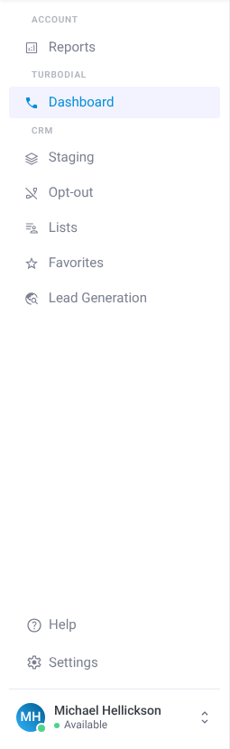
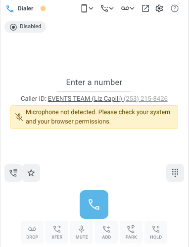
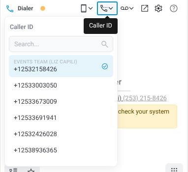
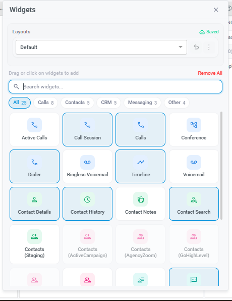

# Your first day {data-eyebrow="Start here"}

TurboDial 2 is where you make calls and send texts. It's linked to Keap, so your calls and notes show up on the Keap contact.

### Before your first call:

1. Log in at **app.turbodial.com** with the email and password your Admin sent you. Change your password in **Settings › Account › Change Password**.
2. Allow your **microphone** when the browser asks.
3. Set your **Caller ID** to **your own number** (SOP 1, step 2).
4. Set **Sending From** to **your own number** (SOP 3, step 3).
5. Install the **Chrome extension** (SOP 2).
6. Call and text a team phone. It must show **your** number.

::: warning
### Golden rules

- Always call and text from **your own number**. Check the Caller ID line at the start of each day.
- Never use another person's number, or a number you don't recognize.
- Something looks wrong, such as the wrong number or no ring? Tell your Admin before you keep calling.
:::

### Your screen

{.side width=150px}

| Menu | What it's for |
|---|---|
| **Dashboard** | Your work screen: calling, texting and contact history. |
| **Reports** | Your call totals. |
| **Staging, Lists, Favorites** | Contact lists and quick-dial contacts. |
| **Opt-out** | People who must not be called or texted. |
| **Help** | Guides and videos. |
| **Settings** | Your profile, password and audio. |

# Make a call {data-eyebrow="SOP 1"}

{.side width=230px}

1. Open **Dashboard** and find the **Dialer** box.
2. **Check your Caller ID.** The line under the number box must say **"Caller ID: *your own number*"**. If it doesn't:
   - click the **Caller ID** icon at the top of the Dialer;
   - search for your number and pick it.
3. Type the number, or open the keypad (bottom right).
4. Click the round blue **Call** button.
5. During the call, use the buttons at the bottom:
   - **Drop:** leave a voice drop;
   - **Xfer:** transfer;
   - **Mute**;
   - **Add:** add someone;
   - **Park**;
   - **Hold**.

### Call a contact

1. Search at the top of the Dashboard (**Ctrl K**), or use **Contact Search**. Type a name, number or email.
2. Click the contact. The Dialer, the texting box and the history all switch to that person.
3. Check your **Caller ID**, then click **Call**.

{width=32%}

# The Chrome extension: call from Keap {data-eyebrow="SOP 2"}

The extension adds TurboDial to Keap. **Hover over a Keap contact's phone number** to see options such as **contact details** and **Call**.

### Install (once)

1. In Chrome, go to the Chrome Web Store and search for **TurboDial Browser Plugin**. The link is also in TurboDial: **Help › Browser Extension › User Manual**.
2. Click **Add to Chrome**, then **Add extension**.
3. Click the puzzle icon in Chrome's toolbar and **pin** TurboDial.

### Use it

1. Keep **TurboDial 2 open** in another Chrome tab, logged in.
2. Check that the Dialer's **Caller ID** is **your own number**. The extension calls from it.
3. Open a contact in **Keap**.
4. **Hover over the phone number.** The TurboDial buttons appear.
5. Click **Call**. TurboDial dials straight away.
6. Or open the menu next to Call:
   - **Focus in TurboDial** shows the contact's details, texts and history;
   - **Create Staging Contact** saves the number in TurboDial.
7. Click the extension icon in the toolbar to see every phone number on the page. Click one to call it.

### Check it calls from your number

1. Make a test call to a team phone.
2. That phone must show **your** number.
3. In TurboDial, open **Calls** or **Contact History**. The call shows your name and number.

# Text a contact and use templates {data-eyebrow="SOP 3"}

1. Open the contact (SOP 1, "Call a contact"). The **Contact Messages** box shows your texts with that person.
2. If they have more than one number, pick one in the drop-down at the top of the box.
3. **Check Sending From** (top right of the box). It must be **your own number**. Replies come back to that number.
4. Type the message and click **Send** (the arrow).

### Use a template

1. Click **Choose Template**, pick one, check the text, then **Send**.
2. **New template:** **Choose Template › Create Template**, then:
   - name it;
   - write the message (you can add first-name and last-name fields);
   - click **Save**.

   Set **Public** only if the whole team should use it.

::: tip
If a contact replies **STOP**, they're opted out. TurboDial won't let you text them again.
:::

# Voice drops {data-eyebrow="SOP 4"}

A voice drop is a recorded message you leave on an answering machine with one click.

### Record your own

1. Go to **Settings › TurboDial › Voice Drops › Add Voice Drop**.
2. Give it a clear name, for example "Francis – Event invite".
3. Then either:
   - click **Start Recording**, speak, then **Stop Recording**; or
   - click **Upload MP3**.
4. Play it back, then click **Add**.

### Use it on a call

1. Before the call, pick the drop in the Dialer's **voice drop** menu (the tape icon).
2. When you reach voicemail, **wait for the beep**, then click **Drop**.
3. The message plays and your call ends by itself. You can start your next call right away.

# After each call: disposition and notes {data-eyebrow="SOP 5"}

1. Open the call in **Contact History**, which is on your Dashboard.
2. Pick the **Disposition**, the call's outcome. For example: Appointment Set, Left Voicemail, No Answer, Event – Registered.
3. Type in **Notes**. Notes save when you click outside the box.
4. The disposition and notes go to the Keap contact. Some dispositions also update the contact's tags in Keap automatically.

::: tip
Pick the disposition right after every call. Reports and Keap follow-ups depend on it.
:::

# Voicemails and missed calls {data-eyebrow="SOP 6"}

1. **New voicemail:** click **Voicemail** at the top right of the Dashboard. Play the message, then call back from the contact.
2. **Missed calls and texts:** check **Notification** (top right) and the **Timeline** box.
3. **Call back** from the contact, so the call goes out from your own number.
4. Your voicemail greeting is set up by your Admin. Ask them if you want to change it.

# Customize your Dashboard {data-eyebrow="SOP 7"}

Your Dashboard is made of boxes, called **widgets**, and you can arrange them how you like.

{.side width=240px}

### Move and resize

1. **Drag** a widget by its title bar to a new spot.
2. Drag its edge to make it bigger or smaller.

### Add or remove widgets

1. Open the **Widgets** panel.
2. Click a widget to add it, or drag it onto the Dashboard. Highlighted widgets are already on your screen.
3. Filter by **Calls**, **Contacts**, **CRM**, **Messaging** and **Other**, or type in **Search widgets**.
4. To remove one, click it again in the panel, or use the **⋮** menu on the widget.

### Layouts

- Your arrangement saves automatically ("Saved" in green).
- Use the drop-down to switch layouts. Use **↺** to undo a change.

### Recommended for daily work:
- Dialer
- Contact Search
- Contact Details
- Contact Messages
- Contact History
- Contact Notes
- Timeline
- Voicemail
